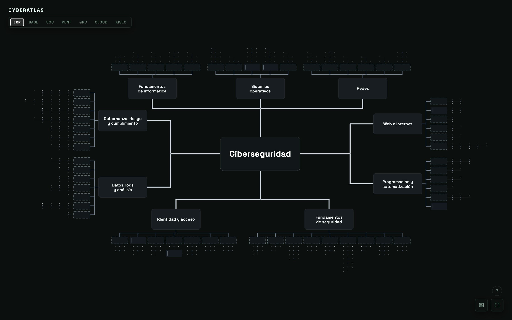
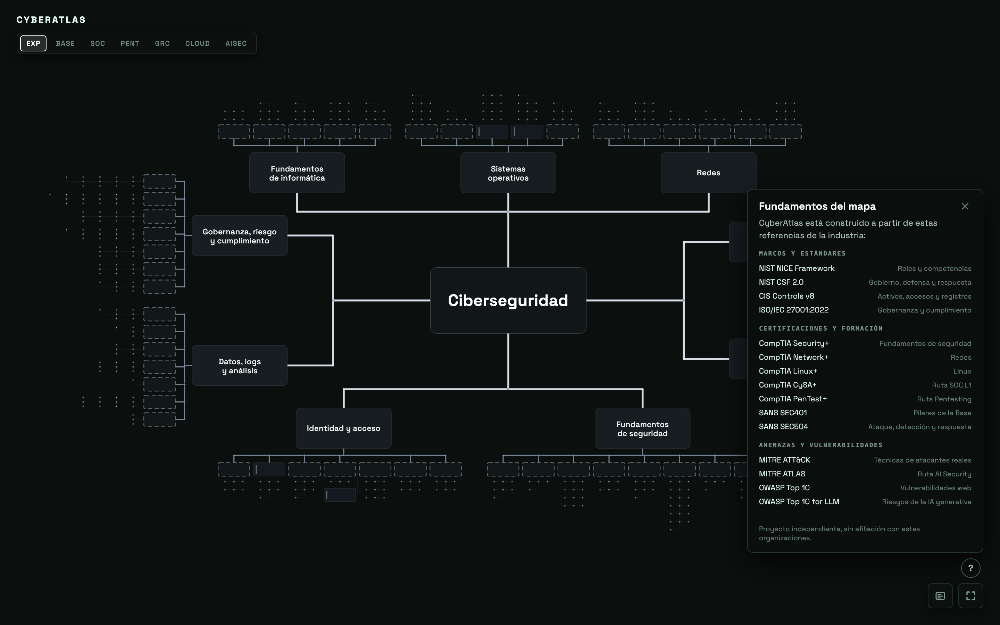

# CyberAtlas

[](https://github.com/fabianubv?tab=repositories&q=topic%3Aherramienta-interactiva-de-estudio) [](https://fabianubv.github.io/cyberatlas/) [](LICENSE)

**Un mapa interactivo para explorar los contenidos de la ciberseguridad.**

La ciberseguridad es enorme y cuesta ver cómo encajan sus partes. CyberAtlas la muestra como un mapa: 357 conocimientos organizados en nueve dominios, conectados como un circuito, con rutas que iluminan lo que importa en cada especialidad.



## Qué se puede hacer

- **Explorar** el mapa completo, con todos los dominios y sus conocimientos.
- **Seguir una ruta:** SOC L1, Pentesting, GRC, Cloud Security o AI Security. **Base** muestra los fundamentos comunes a todas.
- **Navegar:** un clic acerca al nodo y a sus hijos, y otro vuelve al padre. Funciona con ratón, rueda y gestos táctiles.
- **Abrir la ficha de cada nodo:** qué es, y su prioridad y nivel recomendado en la ruta activa. Las fichas se pueden ocultar.
- **Ver los fundamentos:** el botón `?` muestra las referencias en las que se basa el mapa.

## En qué se basa

El mapa está construido a partir de marcos, certificaciones y catálogos de amenazas de la industria:

- **Marcos y estándares:** NIST NICE Framework, NIST CSF 2.0, CIS Controls v8, ISO/IEC 27001:2022.
- **Certificaciones y formación:** CompTIA Security+, Network+, Linux+, CySA+ y PenTest+; SANS SEC401 y SEC504.
- **Amenazas y vulnerabilidades:** MITRE ATT&CK, MITRE ATLAS, OWASP Top 10 y OWASP Top 10 for LLM.

Es un proyecto independiente, sin afiliación con estas organizaciones.



## Usarlo

- **En línea:** [fabianubv.github.io/cyberatlas](https://fabianubv.github.io/cyberatlas/).
- **En tu computador** (Node.js 22.12 o superior):

```bash
npm ci
```

```bash
npm run dev
```

## Cómo está hecho

Es una aplicación React estática (TypeScript y Vite), sin backend, cuentas ni cookies. Todo el contenido viene en el build y el navegador no hace peticiones a terceros. El mapa se dibuja con un único SVG y una sola cámara, y el detalle de cada nodo aparece según el zoom.

| Archivo | Qué contiene |
|---|---|
| `src/data/map.json` | Nodos y relaciones. |
| `src/data/routes.json` | Rutas y relevancia de cada nodo. |
| `src/data/layout.json` | Posiciones y trazado de las conexiones. |
| `src/data.ts` | Carga y valida los datos con Zod. |
| `src/baseRoute.ts` | Calcula la ruta Base. |
| `src/svg-map/` | El mapa: interfaz, lienzo, nodos, conexiones, cámara y panel de fuentes. |
| `public/_headers` | Cabeceras de seguridad (CSP estricta) para servidores que las soportan. |

Lo desarrollé con asistentes de IA (Codex, Antigravity y Claude): yo definí qué temas incluir y cómo organizarlos, diseñé las rutas, elegí las referencias, probé el mapa y revisé los resultados.

### Pruebas

```bash
npm test
```

## Privacidad

Nada sale de tu navegador: no hay servidor, cuentas, cookies ni seguimiento.

## Licencia

[MIT](LICENSE)
